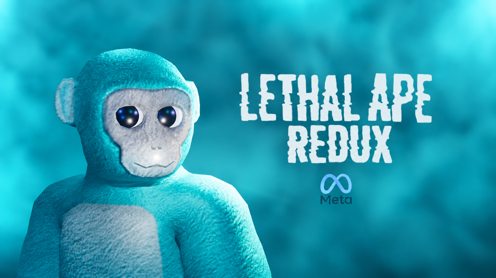

  

🦍 Lethal Ape Redux

An open-source educational and research repository maintained by Icy Games LLC.

Learn. Explore. Experiment. Share.

📖 About

Lethal Ape Redux is an open-source educational and research repository dedicated to documenting, exploring, and learning about Lethal Ape, its gameplay concepts, development technologies, and systems commonly used in VR games.

Whether you're a developer, a beginner learning C#, a VR enthusiast, or simply curious about how games work, this repository is intended to provide useful information and educational resources.

Why just play the game when you can learn how games are made?

💡 Why Open Source?

We believe the modding and game development communities should be about sharing, learning, and improving together.

Too much development knowledge is hidden behind paywalls, private repositories, and obfuscated projects. We want to encourage a different approach.

By keeping this repository open source, we're giving everyone the opportunity to:

Learn how game systems work.
Study C# and Unity development.
Explore VR programming concepts.
Research Lethal Ape gameplay mechanics.
Experiment with educational examples.
Contribute documentation and information.
Help keep learning free and accessible.

⭐ Let's bring back collaboration in development. No unnecessary secrets, no paywalls, just learning and sharing.

❓ Can I Use Your Code?

Of course! This repository is intended to encourage learning and collaboration.

The repository uses the GNU General Public License v3.0 (GPL-3.0) for covered original materials.

This means:

You may use, study, and modify covered code.
You must provide appropriate attribution.
You must preserve applicable copyright and license notices.
Redistributed derivative works must comply with GPL-3.0.
You must provide corresponding source code when required by the license.

Please remember that third-party assets and materials may have separate licensing requirements.

"You wouldn't download knowledge."

⭐ Learn it, understand it, and improve it.

📚 What Can I Learn?

This repository covers a variety of game development and programming concepts.

🦍 Lethal Ape Research
Game information and mechanics.
Gameplay systems.
Player interactions.
Environmental design.
Horror game concepts.
Community research.
💻 Programming
C# fundamentals.
Object-oriented programming.
Classes and methods.
Unity scripting.
Events and callbacks.
Code organization.
🥽 Virtual Reality
VR controller tracking.
Hand-based locomotion.
Rigidbody physics.
Collision detection.
XR interaction.
VR performance optimization.
🤖 Artificial Intelligence
Enemy state machines.
Player detection.
Navigation systems.
Patrol behavior.
Chase behavior.
AI decision-making.
🌐 Multiplayer
Player synchronization.
Network architecture.
Lobby systems.
Connection management.
Network latency.
Multiplayer programming concepts.
🎨 Game Development
3D modeling.
Animations.
Textures and materials.
Audio systems.
Lighting.
Level design.
Note: These are educational areas of study, not claims that every listed system is implemented in Lethal Ape.
🛠️ Development Resources

Here are some technologies and tools worth exploring when learning about VR and game development.

Technology	Purpose
C#	Programming
Unity	Game development
OpenXR	VR integration
Blender	3D modeling
Git	Version control
Visual Studio	Code editing
Rigidbody	Physics
NavMesh	AI navigation
Animator	Character animation
Photon	Multiplayer networking concepts
These are suggested learning resources, not a list of verified project dependencies.
🔬 Educational Code Examples

Want to learn how basic game systems work? Here are some simple examples.

Basic Enemy State System
csharp
public enum EnemyState
{
    Idle,
    Patrol,
    Chase,
    Search
}

public class EnemyExample
{
    public EnemyState State = EnemyState.Idle;

    public void SetState(EnemyState state)
    {
        State = state;
    }
}

Basic Distance Detection
csharp
using UnityEngine;

public class DetectionExample : MonoBehaviour
{
    public Transform target;
    public float detectionRange = 10f;

    void Update()
    {
        if (target == null)
            return;

        float distance = Vector3.Distance(
            transform.position,
            target.position
        );

        if (distance <= detectionRange)
        {
            Debug.Log("Target detected!");
        }
    }
}

These are original educational examples designed to help beginners understand programming concepts.

They are not represented as extracted Lethal Ape source code.

📂 Repository Information

The repository is intended to organize research and learning materials into categories such as:

Directory	Description
Documentation/	General project information
Research/	Lethal Ape-related research
Educational-Examples/	Programming examples
Resources/	Learning resources and permitted assets
Development/	Development notes and guides

The repository structure may evolve as the project grows.

🤝 Want to Contribute?

Contributions are welcome!

If you have useful information, educational examples, documentation, or corrections, feel free to contribute.

How to Contribute
Fork this repository.
Make your changes.
Add useful documentation or educational examples.
Submit a Pull Request.
Wait for review.

Please make sure all contributions are properly credited and that you have permission to share any third-party materials.

🔐 Privacy and Security

We believe learning and development should be responsible.

This repository encourages:

Respecting player privacy.
Protecting sensitive information.
Avoiding malicious software.
Documenting network behavior responsibly.
Conducting responsible security research.
Respecting third-party intellectual property.

Never upload passwords, private keys, tokens, or personal information.

🗣️ Contact Information

Need help or want to collaborate?

Here are the project's official locations:

GitHub Profile: larfan676767
Repository: Lethal Ape Redux
💖 Support

If you wish to support this project, here are some ways you can help!

Platform	How to Support
GitHub	⭐ Star the repository
Contributions	Submit Pull Requests
Issues	Report bugs and suggest improvements
Community	Share the project
Documentation	Help expand learning resources

Every contribution helps keep educational information accessible!

⚖️ Legal Disclaimer
[!NOTE]
This project is an independent educational and research repository maintained by Icy Games LLC.
This project is not affiliated with, endorsed by, or sponsored by Another Axiom LLC.
Gorilla Tag and other third-party names, assets, and materials remain the property of their respective owners.
Third-party materials are not automatically covered by this repository's license.
All third-party trademarks and intellectual property remain the property of their respective owners.
📜 License

Lethal Ape Redux README.md

Copyright (C) 2026 Icy Games LLC

This program is free software: you can redistribute it and/or modify it under the terms of the GNU General Public License as published by the Free Software Foundation, either version 3 of the License, or (at your option) any later version.

This program is distributed in the hope that it will be useful, but WITHOUT ANY WARRANTY; without even the implied warranty of MERCHANTABILITY or FITNESS FOR A PARTICULAR PURPOSE.

See the GNU General Public License for more details.

You should have received a copy of the GNU General Public License along with this program. If not, see:

https://www.gnu.org/licenses/

🦍 Thanks for Checking Out Lethal Ape Redux!

Learn. Explore. Experiment. Share.

